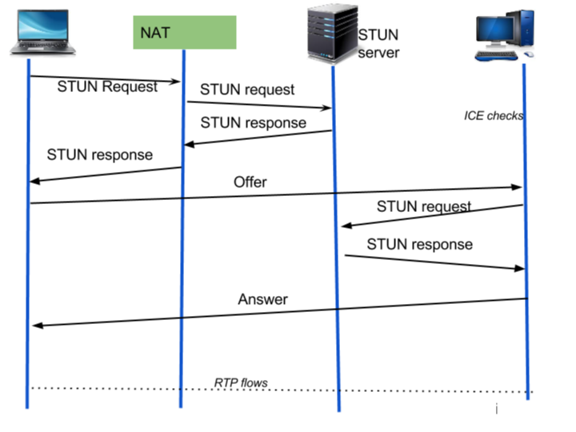

# Taller de Programacion {Grupo}

## Integrantes
- Aaron Sanjines
- Federico Zugna
- Federico Del Pup

## Como usar 

A continuacion se detallan los pasos para compilar y ejecutar el programa.

instalación previa:
sudo apt update
sudo apt install libopencv-dev pkg-config

Yo por la placa de video tuve que instalar aparte:
sudo apt install -y     libopencv-dev     clang     libclang-dev     llvm     llvm-dev     pkg-config     cmake     build-essential

### Compilacion
Cargo build

Cargo clippy --all-targets

### Como correr

Controlled: 
cargo run --bin cliente controlled config/controlled2.config

Controlling:
    - Texto: cargo run --bin cliente controlling config/controlling1.config
    - Imagen: cargo run --bin cliente controlling config/controlling1.config Imagen.jpg
    - Video: cargo run --bin cliente controlling config/controlling1.config video


Para probar la camara web:

cargo run --bin test_cam


## Como testear

## Diagrama de ICE flujo basico



# Configuración TLS para el Signaling Server

## Dependencias necesarias en `Cargo.toml`

```toml
[dependencies]
rustls = "0.23"
rustls-pemfile = "2.0"
serde = { version = "1.0", features = ["derive"] }
serde_json = "1.0"
```

## Generar Certificados para Desarrollo

### Opción 1: Certificados autofirmados con OpenSSL

```bash
# Generar clave privada
openssl genrsa -out server-key.pem 2048

# Generar certificado autofirmado (válido por 365 días)
openssl req -new -x509 -key server-key.pem -out server-cert.pem -days 365 \
  -subj "/C=AR/ST=BuenosAires/L=Caseros/O=MyOrg/CN=localhost"
```

### Opción 2: Con `mkcert` (más fácil para desarrollo local)

```bash
# Instalar mkcert
# En Ubuntu/Debian:
sudo apt install mkcert

# En macOS:
brew install mkcert

# Instalar CA local
mkcert -install

# Generar certificados
mkcert localhost 127.0.0.1 ::1

# Esto genera:
# - localhost+2.pem (certificado)
# - localhost+2-key.pem (clave privada)
```

## Ejemplo de uso del servidor

### `main.rs`

```rust
mod server; // tu mod.rs del servidor

use server::SignalingServer;

fn main() -> std::io::Result<()> {
    let server = SignalingServer::new(
        "127.0.0.1:8443",           // Dirección y puerto
        "users.txt".to_string(),     // Archivo de usuarios
        100,                          // Máximo de conexiones
        "server-cert.pem",           // Certificado
        "server-key.pem",            // Clave privada
    )?;
    
    println!("Servidor iniciado en https://127.0.0.1:8443");
    server.run()
}
```

## Protocolo de Comunicación

El protocolo utiliza **longitud + JSON** sobre TLS:

### Formato del mensaje:
```
[4 bytes: longitud del mensaje en big-endian][N bytes: mensaje JSON]
```

### Ejemplo de mensajes:

**Registro:**
```json
{
  "Register": {
    "username": "alice",
    "password": "pass123",
    "email": "alice@example.com"
  }
}
```

**Login:**
```json
{
  "Login": {
    "username": "alice",
    "password": "pass123"
  }
}
```

**Obtener lista de usuarios:**
```json
{
  "GetUserList": {}
}
```

**Respuesta de lista:**
```json
{
  "UserListResponse": {
    "users": [
      ["alice", "Available"],
      ["bob", "Busy"],
      ["charlie", "Disconnected"]
    ]
  }
}
```

**Iniciar llamada:**
```json
{
  "CallRequest": {
    "callee": "bob"
  }
}
```

**Finalizar llamada:**
```json
{
  "CallEnd": {}
}
```

**Respuesta de éxito:**
```json
{
  "Success": {
    "message": "Usuario registrado exitosamente"
  }
}
```

**Respuesta de error:**
```json
{
  "Error": {
    "message": "Usuario ya existe"
  }
}
```

## Cliente de ejemplo (básico)

```python
#!/usr/bin/env python3
"""
Script ultra-simple para testear el servidor
Uso: python quick_test.py
"""

import socket
import json
import struct
import ssl

def send_recv(host, port, message):
    """Envía un mensaje y muestra la respuesta"""
    
    # Crear contexto SSL (sin verificación para desarrollo)
    context = ssl.create_default_context()
    context.check_hostname = False
    context.verify_mode = ssl.CERT_NONE
    
    # Conectar
    sock = socket.create_connection((host, port))
    tls_sock = context.wrap_socket(sock, server_hostname='localhost')
    
    print(f"Enviando: {json.dumps(message, indent=2)}")
    
    # Serializar mensaje
    json_bytes = json.dumps(message).encode('utf-8')
    length_bytes = struct.pack('!I', len(json_bytes))
    
    # Enviar
    tls_sock.sendall(length_bytes + json_bytes)
    
    # Recibir respuesta
    length_bytes = tls_sock.recv(4)
    length = struct.unpack('!I', length_bytes)[0]
    
    response_bytes = b''
    while len(response_bytes) < length:
        chunk = tls_sock.recv(length - len(response_bytes))
        response_bytes += chunk
    
    response = json.loads(response_bytes.decode('utf-8'))
    print(f"Respuesta: {json.dumps(response, indent=2)}\n")
    
    tls_sock.close()

# ===== TESTS =====

# Test 1: Registro
send_recv('127.0.0.1', 8443, {
    "Register": {
        "username": "alice",
        "password": "pass123",
        "email": "alice@test.com"
    }
})

# Test 2: Login
send_recv('127.0.0.1', 8443, {
    "Login": {
        "username": "alice",
        "password": "pass123"
    }
})

# Test 3: Lista de usuarios
send_recv('127.0.0.1', 8443, {
    "GetUserList": {}
})

```
## Archivo de usuarios (`users.txt`)

Formato: `username|password|email`

```
alice|pass123|alice@example.com
bob|mypassword|bob@example.com
charlie|secret|
```